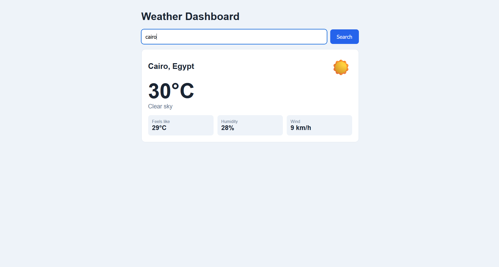

# Weather Dashboard

Assignment 4. Search for a city and see its current weather: temperature, conditions, an icon, feels like, humidity and wind.

## How to run

Open `index.html` in a browser (or use Live Server in VS Code). Type a city name and press Search.

## API key

I used the Open-Meteo API (https://open-meteo.com/).
It is free and doesn't need an API key, so there is no key in this project.

Open-Meteo doesn't need a key, but the assignment says API keys should never be uploaded to GitHub. So I still added a `.env.example` file and put `.env` in `.gitignore`. If someone wants to use another API that needs a key (like OpenWeatherMap), they can make an account to get a key, copy `.env.example` to `.env` and put their key there. This way the key stays on their computer and doesn't get pushed to GitHub.

## Files

- `index.html` - the page
- `css/style.css` - styles
- `js/script.js` - gets the weather from the API and shows it on the page
